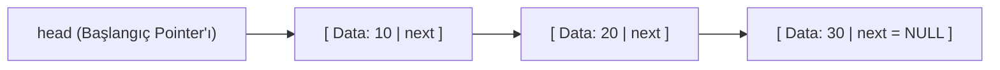
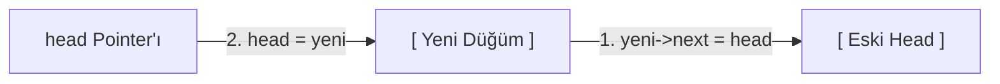
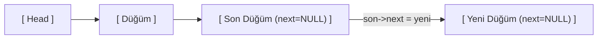
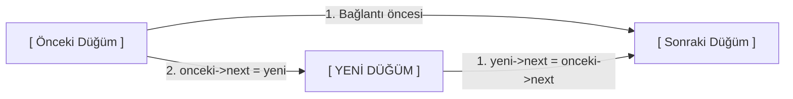
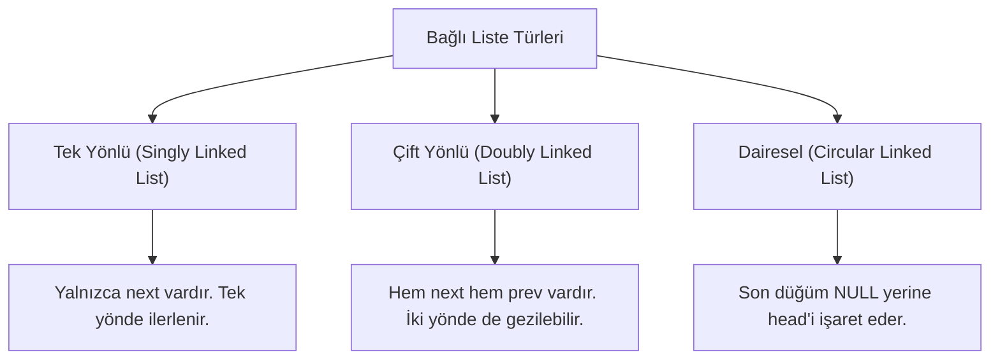

[[XXX_DERS_PROGRAMI]]

# Veri Yapıları

#ders #donem3 #veri_yapilari

> [!NOTE] 𝐾 Goodnotes PDF Defteri & El Yazmaları
> - *Bu klasöre (Veri Yapıları) henüz PDF eklenmedi.*

---

## Döngülerde (for) Zaman Karmaşıklığı (Big-O Analizi Rehberi)

Bir `for` döngüsünün **Big-O (Zaman Karmaşıklığı)** derecesi, döngü değişkeninin **başlangıç değerine**, **bitiş koşuluna** ve her adımda **nasıl güncellendiğine (artış/azalış miktarına)** bağlı olarak belirlenir.

Temel kural şudur: **"Döngü gövdesi girdi boyutu olan $n$'e bağlı olarak kaç defa çalışıyor?"**

---

### 1. Doğrusal Döngüler — $O(n)$
Döngü değişkeni her adımda **sabit bir miktar eklenerek veya çıkarılarak** ilerliyorsa döngü $n$'e orantılı adımda biter.

#### a) Standart Birer Artış
```c
for (int i = 0; i < n; i++) {
    // Toplam adım: n kez -> O(n)
}
```

#### b) Sabit Miktarda Artış ($c$ kadar)
```c
for (int i = 0; i < n; i += 2) {
    // Toplam adım: n / 2 kez
    // Sabit katsayılar ihmal edilir -> O(n)
}
```

#### c) Geriye Doğru Azalış
```c
for (int i = n; i > 0; i--) {
    // Toplam adım: n kez -> O(n)
}
```

---

### 2. Sabit Zamanlı Döngüler — $O(1)$
Döngünün çalışma sayısı $n$ girdisine **bağlı değilse**, döngü 1 milyon kez dönse bile sabit zamanlıdır.

```c
for (int i = 0; i < 1000; i++) {
    // n'den bağımsız, daima 1000 adım -> O(1)
}
```

---

### 3. Logaritmik Döngüler — $O(\log n)$
Döngü değişkeni her adımda **sabit bir sayı ile çarpılıyor veya bölünüyorsa**, adım sayısı logaritmik olarak küçülür/büyür.

#### a) İkiye Katlayarak İlerleme
```c
for (int i = 1; i < n; i *= 2) {
    // Adımlar: 1, 2, 4, 8, 16, ..., 2^k ≈ n
    // k = log2(n) -> O(log n)
}
```

#### b) Yarıya İndirerek İlerleme
```c
for (int i = n; i > 1; i /= 2) {
    // n, n/2, n/4, ..., 1
    // Toplam adım: log2(n) -> O(log n)
}
```

> **Not:** Çarpanın $2, 3$ veya $10$ olması Big-O derecesini değiştirmez; logaritma taban değişimi katsayı farkı yaratır ve katsayılar ihmal edilir ($\log_2 n \approx c \cdot \log_{10} n \rightarrow O(\log n)$).

---

### 4. Karekök Döngüleri — $O(\sqrt{n})$
Döngünün durma koşulu değişkenin karesine bağlıysa veya adım $i^2 < n$ şeklinde test ediliyorsa karmaşıklık $O(\sqrt{n})$ olur.

```c
for (int i = 1; i * i < n; i++) {
    // i^2 < n  ==>  i < sqrt(n)
    // Toplam adım: √n -> O(√n)
}
```
*(Örnek: Asal sayı kontrolü algoritmaları)*

---

### 5. Çift Logaritmik Döngüler — $O(\log(\log n))$
Döngü değişkeni her adımda kendi karesi alınarak büyütülüyorsa:

```c
for (int i = 2; i < n; i = i * i) {
    // Adımlar: 2, 4, 16, 256, 65536, ...
    // Adım sayısı: log2(log2(n)) -> O(log(log n))
}
```

---

### 6. İç İçe Döngüler (Nested Loops)

İç içe döngülerde toplam karmaşıklık, **dıştaki döngü sayısı ile içteki döngünün her seferinde kaç kez çalıştığının çarpımı/toplamı** ile bulunur.

#### a) Bağımsız İç İçe Döngüler — $O(n^2)$
İç döngünün sınırları dış döngüden bağımsızsa basitçe çarpılır:
```c
for (int i = 0; i < n; i++) {         // n kez
    for (int j = 0; j < n; j++) {     // n kez
        // Toplam: n * n = n^2 -> O(n^2)
    }
}
```
*(Eğer boyutlar farklıysa, örn. $n$ ve $m$: $O(n \cdot m)$ olur).*

#### b) Bağımlı İç İçe Döngüler (Üçgensel Döngüler) — $O(n^2)$
İç döngü dış döngünün o anki değerine ($i$) bağlı olsa bile:
```c
for (int i = 0; i < n; i++) {
    for (int j = 0; j < i; j++) {
        // i=0 iken 0 adım
        // i=1 iken 1 adım
        // ...
        // i=n-1 iken n-1 adım
        // Toplam = 1 + 2 + ... + (n-1) = n*(n-1)/2 ≈ (n^2)/2 -> O(n^2)
    }
}
```

#### c) Doğrusal + Logaritmik İç İçe Döngü — $O(n \log n)$
Dış döngü doğrusal, iç döngü logaritmik adımlarla ilerliyorsa:
```c
for (int i = 0; i < n; i++) {         // n kez
    for (int j = 1; j < n; j *= 2) {  // log n kez
        // Toplam: n * log n -> O(n log n)
    }
}
```

---

### ÖZET TABLOSU

| Döngü <br>/ Koşul         | Örnek Sözdizimi        | Karmaşıklık           | Mantık                                    |
| :------------------------ | :--------------------- | :-------------------- | :---------------------------------------- |
| **Sabit limit**           | `i < 50; i++`          | **$O(1)$**            | $n$'den bağımsız sabit adım               |
| **Toplama / Çıkarma**     | `i += c` veya `i -= c` | **$O(n)$**            | Eşit aralıklarla doğrusal tarama          |
| **Çarpma / Bölme**        | `i *= c` veya `i /= c` | **$O(\log n)$**       | Her adımda aralık $c$ katına çıkar / iner |
| **Karesel Koşul**         | `i * i < n; i++`       | **$O(\sqrt{n})$**     | $i$'nin ulaşacağı üst sınır $\sqrt{n}$    |
| **Kuvvet Alma**           | `i = i * i`            | **$O(\log(\log n))$** | Üstel hızda katlanarak büyüme             |
| **İç İçe Doğrusal**       | $n$ içinde $n$         | **$O(n^2)$**          | $n \times n$ matris taraması              |
| **İç İçe Doğrusal + Log** | $n$ içinde $\log n$    | **$O(n \log n)$**     | Çoğu böl-ve-yönet/sıralama algoritması    |

---

### Analiz Ederken Dikkat Edilecek 3 Altın Kural

1. **Gövde Maliyetini Unutmayın:**  
   Döngünün kendisi $O(n)$ dönüyor olabilir; ancak döngü içinde çağrılan bir fonksiyon da $O(n)$ ise toplam maliyet $O(n \cdot n) = O(n^2)$ olur.
2. **Sabitler ve Düşük Dereceli Terimler Atılır:**  
   $3n + 5 \log n + 100 \rightarrow O(n)$
3. **`break` / `return` Durumları:**  
   En kötü durum analizi (**Worst Case**) yapılıyorsa döngünün erken çıkmadığı ve sonuna kadar gittiği senaryo baz alınır. Ortalama veya en iyi durum soruluyorsa `break` koşulunun olasılığı hesaba katılır.


## 30 EKİM: Yapı (struct), Düğüm (Node) ve Bağlı Liste (Linked List)

Veri yapılarındaki **Yapı (struct)**, **Node (Düğüm)** ve **Bağlı Liste (Linked List)** konularının temel mantığı, bellek yapısı ve operasyonları:

---

### 1. Temel Benzetme: Tren ve Vagonlar 🚂

* **Dizi (Array):** Yan yana sabitlenmiş, boyutu baştan tanımlı ve arasına yeni eleman eklemek için kaydırma gerektiren kutular dizisidir.
* **Bağlı Liste (Linked List):** Birbirine dinamik işaretçilerle (pointer) bağlanmış bir **tren** gibidir.
* **Düğüm (Node / Vagon):** Trenin her bir bağımsız vagonudur.
  * **Veri Alanı (`data`):** Vagonun içinde taşınan yük (örn: `int data = 10;`).
  * **İşaretçi Alanı (`next`):** Bir sonraki vagonu gösteren kanca / bellek adresi (`struct Node* next;`).
* **`head` (Lokomotif / Başlangıç):** Listenin ilk düğümünün bellek adresini tutan ana işaretçidir.
* **`NULL` (Bitiş):** Son vagonun arkasında başka bir düğüm olmadığını belirten boşluk adresidir.



---

### 2. Temel Kavramlar ve C Sözdizimi

#### A. Yapı (`struct`) Nedir?
Farklı türdeki verileri (örneğin bir `int` ve bir `pointer`) tek bir çatı altında toplayan kullanıcı tanımlı veri tipidir:

```c
struct Node {
    int data;            // Düğümün taşıdığı veri
    struct Node* next;   // Bir sonraki düğümün bellek adresi
};
```

#### B. Düğüm (`Node`) Oluşturma
Bellekte `malloc` ile dinamik olarak yer açılır:

```c
struct Node* yeni = (struct Node*)malloc(sizeof(struct Node));
yeni->data = 10;
yeni->next = NULL;
```

---

### 3. Çalışan Tam C Kodu (Oluşturma, Bağlama, Traversal ve Bellek Temizleme)

```c
#include <stdio.h>
#include <stdlib.h> // malloc ve free fonksiyonları için

// 1. Düğüm Şablonu
struct Node {
    int data;
    struct Node* next;
};

int main() {
    // 2. Bellekte 3 adet bağımsız düğüm oluşturalım
    struct Node* bir = (struct Node*)malloc(sizeof(struct Node));
    struct Node* iki = (struct Node*)malloc(sizeof(struct Node));
    struct Node* uc  = (struct Node*)malloc(sizeof(struct Node));

    // 3. Düğümlere değerlerini atayalım
    bir->data = 10;
    iki->data = 20;
    uc->data  = 30;

    // 4. Düğümleri birbirine bağlayalım (Zincirleme)
    bir->next = iki;   // 1 -> 2
    iki->next = uc;    // 2 -> 3
    uc->next  = NULL;  // 3 -> NULL (Bitiş)

    // 5. Başlangıç işaretçisi
    struct Node* head = bir;

    // 6. Listeyi Gezinme (Traversal)
    printf("Bagli Liste: ");
    struct Node* temp = head;
    while (temp != NULL) {
        printf("[%d] -> ", temp->data);
        temp = temp->next;
    }
    printf("NULL\n");

    // 7. Bellek İadesi (Memory Deallocation)
    free(bir);
    free(iki);
    free(uc);

    return 0;
}
```

---

### 4. Dizi (Array) ile Bağlı Liste (Linked List) Karşılaştırması

| Kriter | Dizi (Array) | Bağlı Liste (Linked List) |
| :--- | :--- | :--- |
| **Boyut (Size)** | Sabittir (Derleme veya tanımlama anında belirlenir). | Dinamiktir (İhtiyaç duyuldukça büyür / küçülür). |
| **Bellek Yerleşimi** | Bellekte ardışık (contiguous) sıralanır. | Belleğin dağınık bölgelerinde yer alabilir. |
| **Rastgele Erişim** | $O(1)$ sürede doğrudan `dizi[i]` ile erişilir. | $O(n)$ sürede baştan sona adım adım ilerlenir. |
| **Araya Eleman Ekleme** | Elemanları kaydırmak gerekir ($O(n)$). | Sadece iki pointer güncellenir ($O(1)$). |
| **Bellek Ek Maliyeti** | Yalnızca veriler saklanır. | Her eleman için ek olarak `next` pointer saklanır. |

---

## Bağlı Liste Temel İşlemleri 𝐾

### 1. Gezinme (Traversal) 𝐾

Bağlı listede bir elemanı ekrana yazdırmak, saymak veya aramak için `head` noktasından başlayarak `NULL` görene kadar vagon vagon ilerlenir.

* **Zaman Karmaşıklığı:** $O(n)$ — $n$ elemanlı bir listede tüm elemanlar tek tek ziyaret edilir.

```c
void listeyiYazdir(struct Node* head) {
    struct Node* temp = head; // head adresini kaybetmemek için gezgin pointer kullanılır
    
    while (temp != NULL) {
        printf("[%d] -> ", temp->data);
        temp = temp->next; // Bir sonraki düğüme geç
    }
    printf("NULL\n");
}
```

---

### 2. Eleman Ekleme İşlemleri (Insertion) 𝐾

> [!IMPORTANT] Bağlantı Kurma Sırası
> Yeni bir düğüm eklerken yeni düğümün `next` bağı bağlanmadan eski bağlar koparılmamalıdır. Aksi takdirde listenin devamı kaybolur (*Dangling Pointer / Memory Leak*).

#### a) En Başa Eleman Ekleme (Insert at Beginning) — $O(1)$ 𝐾
Listenin en başına yeni bir lokomotif bağlama işlemidir.



```c
void basaEkle(struct Node** head_ref, int yeni_veri) {
    // 1. Yeni düğüm için bellek ayır
    struct Node* yeni_dugum = (struct Node*)malloc(sizeof(struct Node));
    yeni_dugum->data = yeni_veri;
    
    // 2. Yeni düğümün next'ini mevcut head yap
    yeni_dugum->next = (*head_ref);
    
    // 3. head işaretçisini yeni düğüm olarak güncelle
    (*head_ref) = yeni_dugum;
}
```

---

#### b) En Sona Eleman Ekleme (Insert at End) — $O(n)$ 𝐾
Listenin sonuna yeni bir vagon bağlama işlemidir. Son düğümü bulmak için liste taranır.



```c
void sonaEkle(struct Node** head_ref, int yeni_veri) {
    // 1. Yeni düğüm oluştur
    struct Node* yeni_dugum = (struct Node*)malloc(sizeof(struct Node));
    yeni_dugum->data = yeni_veri;
    yeni_dugum->next = NULL;
    
    // 2. Liste tamamen boşsa doğrudan head olur
    if (*head_ref == NULL) {
        *head_ref = yeni_dugum;
        return;
    }
    
    // 3. Son düğüme kadar ilerle (Traversal)
    struct Node* son = *head_ref;
    while (son->next != NULL) {
        son = son->next;
    }
    
    // 4. Son düğümün ucunu yeni düğüme bağla
    son->next = yeni_dugum;
}
```

---

#### c) Araya / Ortaya Eleman Ekleme (Insert After Node) — $O(1)$ 𝐾
Hedeflenen bir düğümün hemen ardına yeni eleman yerleştirilir.



```c
void arayaEkle(struct Node* onceki_dugum, int yeni_veri) {
    // 1. Önceki düğümün geçerliliğini kontrol et
    if (onceki_dugum == NULL) {
        printf("Hata: Referans düğüm NULL olamaz!\n");
        return;
    }
    
    // 2. Yeni düğüm oluştur
    struct Node* yeni_dugum = (struct Node*)malloc(sizeof(struct Node));
    yeni_dugum->data = yeni_veri;
    
    // 3. Önce yeni düğümü sonrakine bağla
    yeni_dugum->next = onceki_dugum->next;
    
    // 4. Sonra önceki düğümü yeni düğüme bağla
    onceki_dugum->next = yeni_dugum;
}
```

---

### 3. Eleman Silme İşlemleri (Deletion) 𝐾

Dinamik olarak ayrılan düğümlerin silindikten sonra `free()` ile belleğe iade edilmesi şarttır.

#### a) Baştan Eleman Silme — $O(1)$ 𝐾
```c
void bastanSil(struct Node** head_ref) {
    if (*head_ref == NULL) return; // Liste boşsa işlem yapma
    
    struct Node* silinecek = *head_ref;
    *head_ref = (*head_ref)->next; // head'i 2. düğüme geçir
    free(silinecek);               // Eski 1. düğümü bellekten temizle
}
```

#### b) Sondan Eleman Silme — $O(n)$ 𝐾
```c
void sondanSil(struct Node** head_ref) {
    if (*head_ref == NULL) return;
    
    // Listede tek düğüm varsa
    if ((*head_ref)->next == NULL) {
        free(*head_ref);
        *head_ref = NULL;
        return;
    }
    
    // Sondan bir önceki düğümü bul
    struct Node* temp = *head_ref;
    while (temp->next->next != NULL) {
        temp = temp->next;
    }
    
    free(temp->next);  // Son düğümü sil
    temp->next = NULL; // Sondan bir öncekini yeni son yap
}
```

#### c) Değere Göre Aradan Silme — $O(n)$ 𝐾
```c
void degereGoreSil(struct Node** head_ref, int silinecek_deger) {
    struct Node* temp = *head_ref;
    struct Node* prev = NULL;
    
    // Silinecek eleman ilk düğümse
    if (temp != NULL && temp->data == silinecek_deger) {
        *head_ref = temp->next;
        free(temp);
        return;
    }
    
    // Değeri ara ve prev işaretçisini arkadan yürüt
    while (temp != NULL && temp->data != silinecek_deger) {
        prev = temp;
        temp = temp->next;
    }
    
    // Değer listede bulunamadıysa çık
    if (temp == NULL) return;
    
    // Düğümü atla ve belleği serbest bırak
    prev->next = temp->next;
    free(temp);
}
```

---

### 4. Arama (Search) ve Liste Uzunluğu (Count) 𝐾

```c
// Değer Arama - O(n)
int elemanAra(struct Node* head, int aranan) {
    struct Node* current = head;
    while (current != NULL) {
        if (current->data == aranan) return 1; // Bulundu
        current = current->next;
    }
    return 0; // Bulunamadı
}

// Eleman Sayısı Bulma - O(n)
int listeUzunlugu(struct Node* head) {
    int sayac = 0;
    struct Node* current = head;
    while (current != NULL) {
        sayac++;
        current = current->next;
    }
    return sayac;
}
```

---

### 5. Sınavların Favorisi: Listeyi Ters Çevirme (Reverse Linked List) 𝐾

İşaretçilerin yönünü ek bir dizi/bellek kullanmadan ($O(1)$ alan karmaşıklığı) tersine çeviren 3 işaretçili algoritma:

* **Zaman Karmaşıklığı:** $O(n)$
* **Bellek Karmaşıklığı:** $O(1)$

```c
void listeyiTersCevir(struct Node** head_ref) {
    struct Node* prev = NULL;
    struct Node* current = *head_ref;
    struct Node* next = NULL;
    
    while (current != NULL) {
        next = current->next;    // 1. Kopmadan önce sonraki düğümü sakla
        current->next = prev;    // 2. Okun yönünü geriye çevir
        prev = current;          // 3. prev işaretçisini bir adım ilerlet
        current = next;          // 4. current işaretçisini bir adım ilerlet
    }
    *head_ref = prev; // Listenin yeni başı (head) en son düğüm olur
}
```

---

### 6. Bağlı Liste Türleri (Teorik Soru Tipleri) 𝐾



1. **Tek Yönlü Bağlı Liste (Singly):** Yalnızca `next` işaretçisi barındırır. Minimum bellek harcar ancak geri dönüşü yoktur.
2. **Çift Yönlü Bağlı Liste (Doubly):** Hem `next` hem `prev` işaretçisi barındırır. Geriye doğru hareket edilebilir ancak düğüm başına ek bellek tüketir.
3. **Dairesel Bağlı Liste (Circular):** Son düğümün `next`'i `NULL` yerine `head` adresini gösterir. Sürekli dönen yapılarda (örn: CPU Scheduler kuyrukları) tercih edilir.

---

### 7. Zaman ve Alan Karmaşıklığı (Big-O) Özet Tablosu 𝐾

| İşlem | Zaman Karmaşıklığı | Açıklama |
| :--- | :--- | :--- |
| **Başa Ekleme / Silme** | **$O(1)$** | Liste boyutu $n$'den bağımsız sabit süre |
| **Sona Ekleme / Silme** | **$O(n)$** | Son düğüme kadar traverse edilir (`tail` tutulmuyorsa) |
| **Araya Ekleme / Silme** | **$O(1)$** | İlgili düğümün adresi biliniyorsa sabit sürede bağlanır |
| **Arama / İndeks Erişimi** | **$O(n)$** | Baştan itibaren tek tek taranır |
| **Listeyi Ters Çevirme** | **$O(n)$** | Tüm düğümler 1 kez ziyaret edilerek yönleri değiştirilir |

---

### 8. Sınavlarda Puan Kırdıran Kritik Noktalar 𝐾

1. **`NULL` Kontrolü (Segmentation Fault):** Listede işlem yaparken `head == NULL` durumunu kontrol etmemek programı çökertebilir.
2. **Bellek Sızıntısı (Memory Leak):** Düğüm silindiğinde `free()` fonksiyonunu çağırmayı unutmamak gerekir.
3. **Bağlantı Sırası Hatası:** Yeni düğüm eklerken önce `onceki->next = yeni` yapılırsa, listenin kalanı kaybolur. Daima önce `yeni->next = onceki->next` yapılmalıdır.


